# Iniciación a la virtualización

Autor: Jesús Andújar Fernández

### Iniciación a la virtualización

Instalación de Ubuntu en VirtualBox y uso de Docker con Nginx y Tomcat

En este trabajo voy contando, paso a paso, cómo he preparado la máquina virtual y cómo he

conseguido poner a funcionar dos servidores con Docker. He añadido las capturas que hice durante la

práctica para enseñar qué pasó en cada momento.

## 1. Crear la máquina virtual de Ubuntu

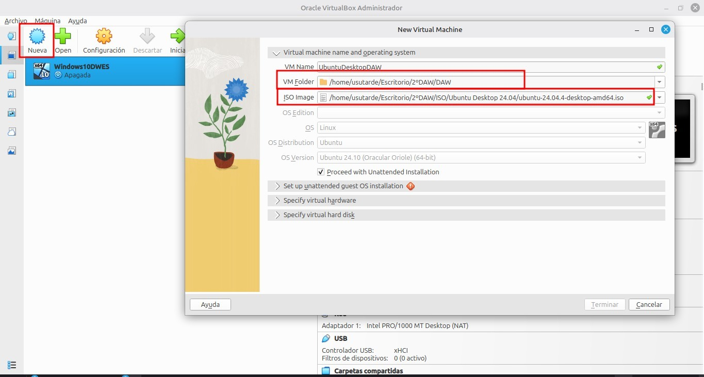

Primero abrí VirtualBox y le di a crear una máquina virtual nueva. Elegí Ubuntu y seleccioné el archivo

ISO que había descargado para poder instalarlo.

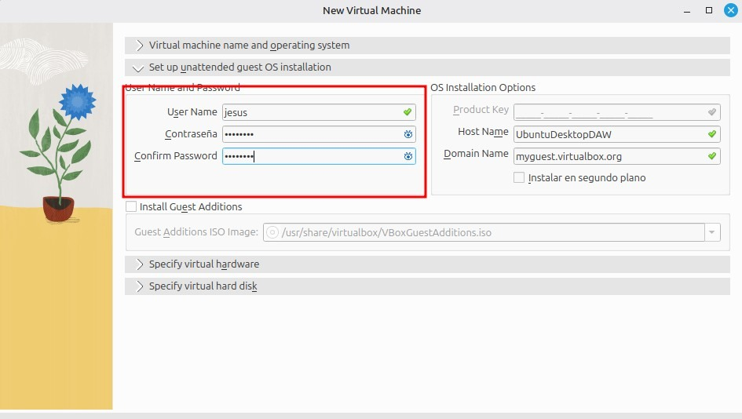

Después escribí mi nombre de usuario, la contraseña y el nombre del equipo. Estos datos son los que

uso para entrar en Ubuntu.

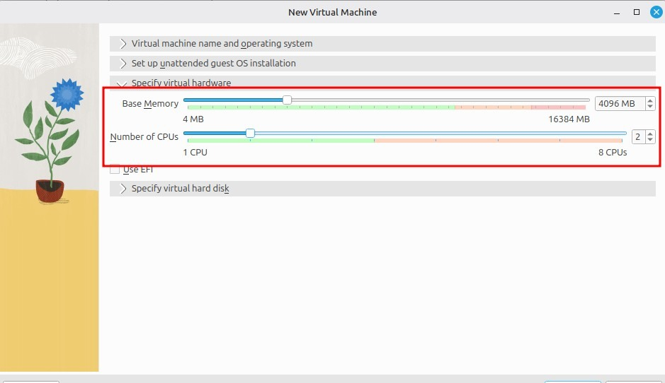

Aquí le asigné 4096 MB de RAM (4 GB) y 2 procesadores. Así la máquina virtual tiene recursos para

funcionar sin utilizar todo lo que tiene mi ordenador.

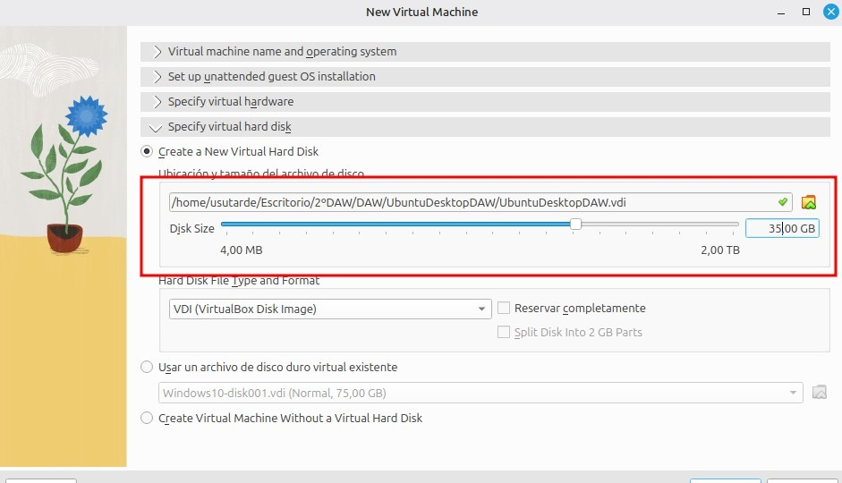

En este paso preparé el disco duro virtual donde se guardaría Ubuntu y todo lo que iba a instalar. En la

captura aparece un tamaño de unos 35 GB.

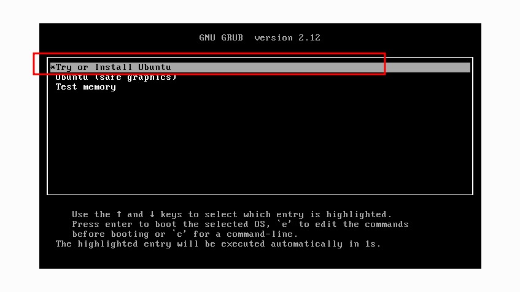

Al iniciar la máquina me salió el menú de Ubuntu. Seleccioné la opción Try or Install Ubuntu para

empezar la instalación.

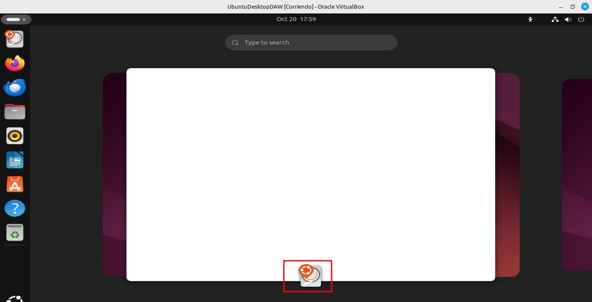

Cuando terminó el arranque, pude entrar al escritorio de Ubuntu dentro de VirtualBox. Con esto ya

tenía la máquina preparada para seguir con Docker.

## 2. Preparar Docker en Ubuntu

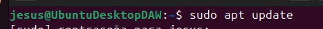

Empecé por ejecutar sudo apt update. Esto sirve para actualizar la lista de paquetes disponibles antes

de instalar otros programas.

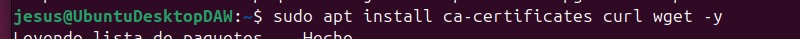

Después instalé ca-certificates, curl y wget. Son herramientas que me sirven para descargar archivos y

trabajar con repositorios desde la terminal.

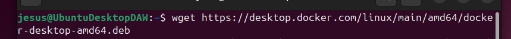

Usé wget para descargar el archivo .deb de Docker Desktop desde su página de descargas.

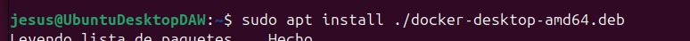

Una vez descargado, ejecuté sudo apt install ./docker-desktop-amd64.deb para instalarlo.

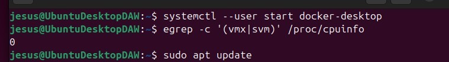

Intenté abrir Docker Desktop, pero no arrancó porque la máquina virtual no tenía disponible KVM. Al

comprobar la virtualización, el resultado fue 0. Por eso continué con Docker Engine, que sí me permite

hacer los ejercicios desde la terminal.

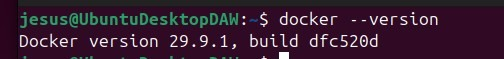

Escribí docker --version para comprobar que el comando estaba instalado. En mi captura aparece la

versión 29.9.1.

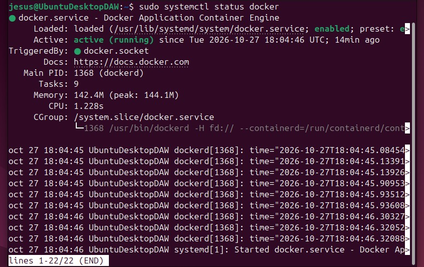

Con sudo systemctl status docker comprobé que el servicio estaba active (running). Eso quiere decir que

Docker Engine estaba funcionando.

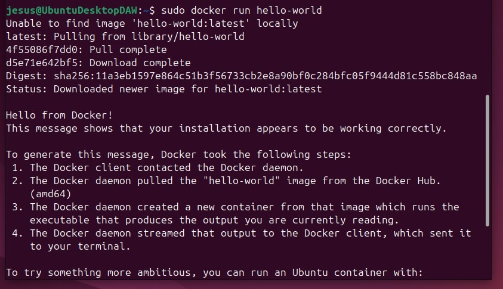

Ejecuté sudo docker run hello-world. Docker descargó la imagen y salió el mensaje Hello from Docker!,

así que ya sabía que podía crear contenedores.

## 3. Montar el servidor web Nginx

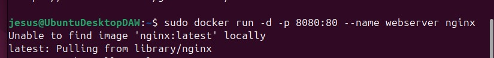

Usé sudo docker run -d -p 8080:80 --name webserver nginx Este comando descarga Nginx si hace falta y

crea un servidor web que se puede visitar desde el puerto 8080.

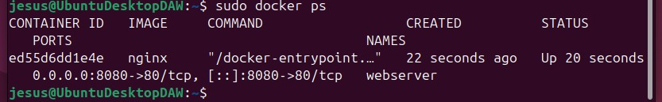

Con sudo docker ps comprobé que el contenedor webserver estaba encendido y que tenía conectado el

puerto 8080.

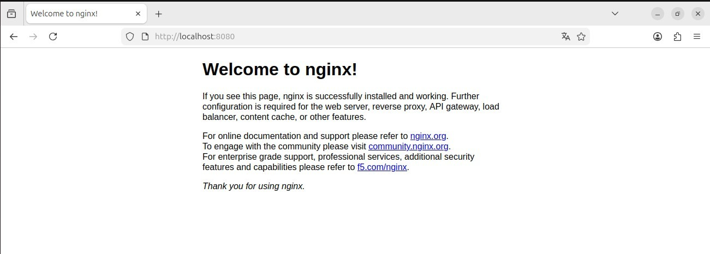

Entré en «http://localhost:8080» y apareció «Welcome to nginx!». Esto confirmó que el servidor web

respondía bien.

## 4. Montar el servidor de aplicaciones Tomcat

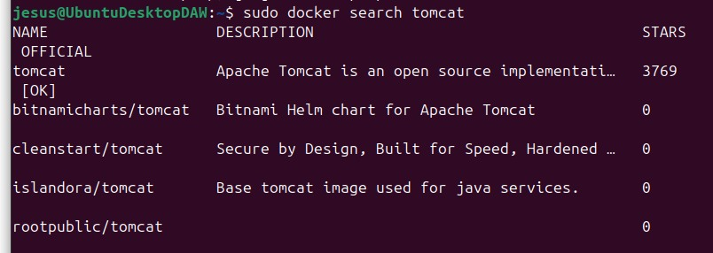

Después busqué Tomcat con «sudo docker search tomcat». Así pude ver que había una imagen

disponible para instalar el servidor de aplicaciones.

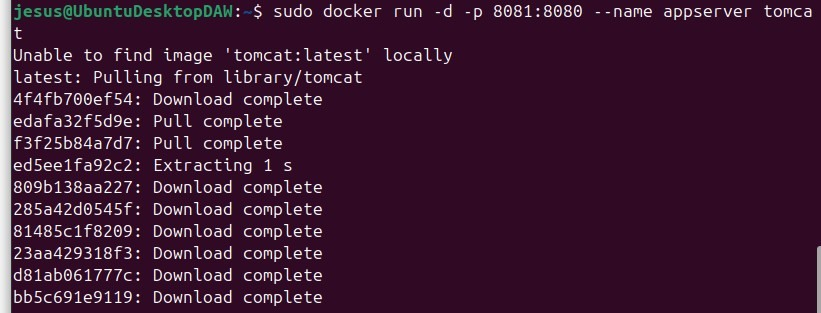

Ejecuté «sudo docker run -d -p 8081:8080 --name appserver tomcat». Con esto creé otro contenedor

para Tomcat, usando el puerto 8081.

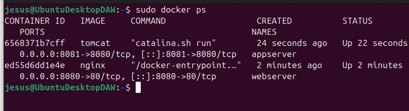

Volví a usar «sudo docker ps» y vi los dos contenedores funcionando al mismo tiempo: «webserver» y

«appserver».

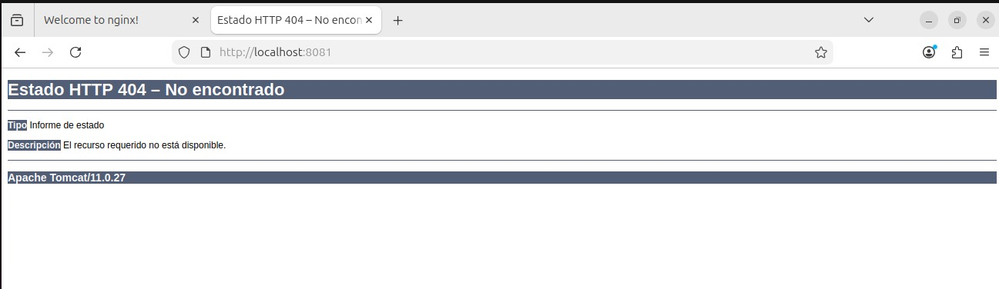

Al entrar en «http://localhost:8081», la página mostraba un error 404. Tomcat sí respondía, pero todavía

no tenía activada una página de inicio en esa ruta.

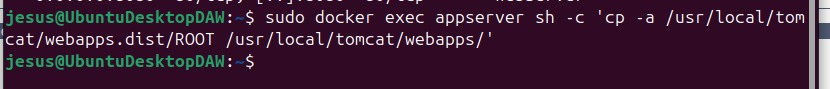

Para solucionarlo, copié la carpeta ROOT de «webapps.dist» a «webapps» dentro del contenedor. Así

Tomcat ya podía enseñar su página de bienvenida.

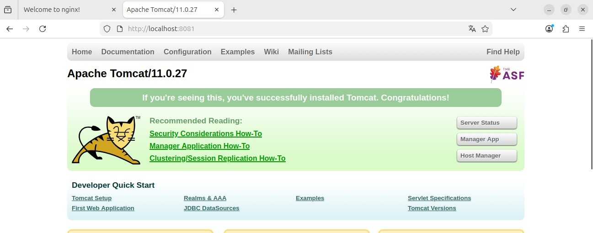

Actualicé el navegador y esta vez apareció la página de Apache Tomcat 11.0.27. Ya tenía el servidor de

aplicaciones funcionando.

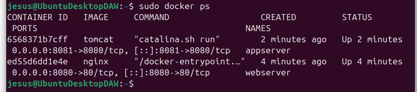

Por último, ejecuté otra vez «sudo docker ps» y comprobé que seguían activos los dos: Nginx en el

puerto 8080 y Tomcat en el 8081.

## 5. ¿Qué hace falta para poner una aplicación web?

Hardware y programas

Hace falta un ordenador o servidor con suficiente memoria, procesador y espacio de disco. También

necesitamos un sistema operativo, Docker y las imágenes de los servidores o de la aplicación que

queramos usar.

Conexión de red

La máquina debe tener conexión a Internet para descargar las imágenes. Los puertos tienen que estar

bien configurados: en mi práctica utilicé 8080 para Nginx y 8081 para Tomcat.

Servidor web y servidor de aplicaciones

Nginx se encarga de recibir las visitas a una página web. Tomcat sirve para ejecutar aplicaciones web

hechas con Java. En esta práctica los he probado por separado para comprobar que los dos funcionan.

Seguridad y mantenimiento

Conviene mantener Ubuntu y las imágenes de Docker actualizadas, usar contraseñas seguras, abrir

solamente los puertos necesarios y revisar que los contenedores sigan funcionando.

## 6. Conclusión

Al principio intenté usar Docker Desktop, pero no se pudi abrir por un problema con la virtualización

KVM de VirtualBox. Al final utilicé Docker Engine, que me permitió hacer las pruebas sin problema.

Conseguí arrancar Nginx y Tomcat, entrar a sus páginas desde Firefox y comprobar que los dos

contenedores estaban activos a la vez. Así he aprendido la diferencia entre instalar una máquina virtual

y utilizar contenedores dentro de ella.

Nota para la entrega: la práctica original pide Docker Desktop. Aquí se ha utilizado Docker Engine como

alternativa por la limitación de KVM. Es conveniente indicárselo al profesor para confirmar que acepta el

cambio.
