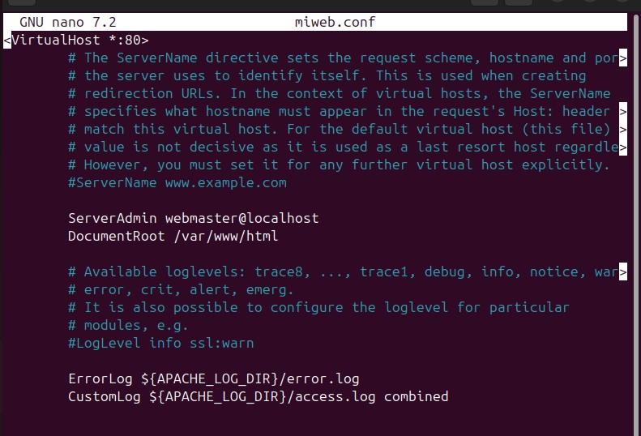
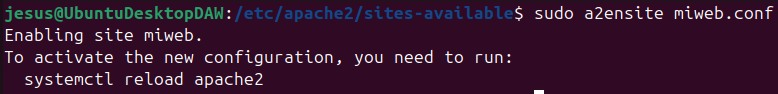
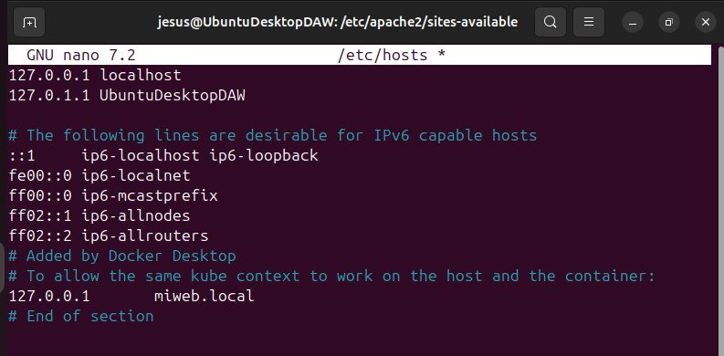
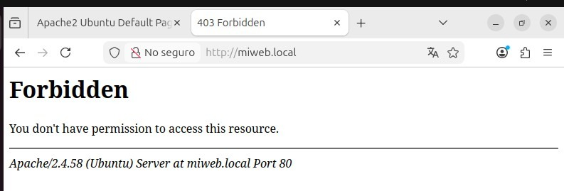
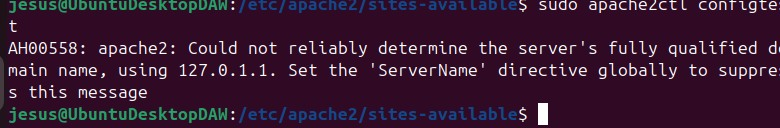
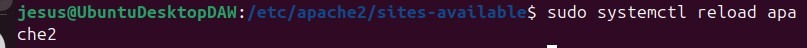
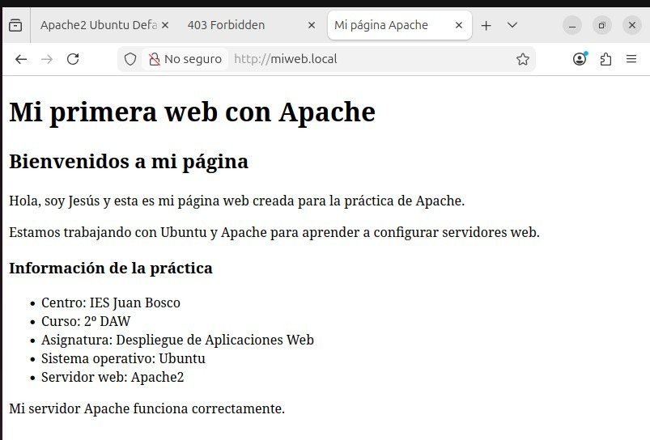
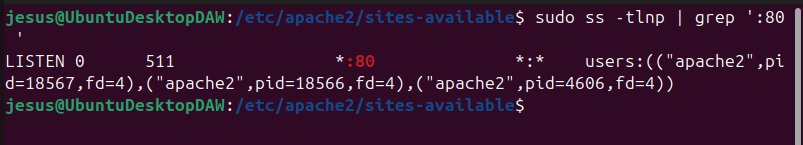
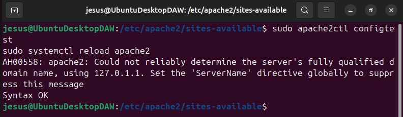

# Apache: Configuración

Autor: Jesús Andújar Fernández

## 1. Introducción

En esta práctica hemos trabajado con Apache en una máquina virtual con Ubuntu. La idea era conseguir que el servidor funcionara, hacer una página web nuestra y configurarlo para poder abrirla desde el navegador. También hemos probado a bloquear el acceso a la página y a volver a permitirlo, para ver cómo funciona esa parte de Apache. He utilizado la terminal de Ubuntu para los comandos, nano para editar archivos y Firefox para comprobar si la web se veía bien. La página se ha guardado en una carpeta llamada miweb y hemos utilizado la dirección miweb.local para entrar.

## 2. Actividades realizadas

### 2.1. Comprobar la versión de Apache

Primero comprobé qué versión de Apache tenía instalada. Al principio el comando no aparecía porque todavía no estaba instalado en esta máquina. Después de instalarlo volví a comprobarlo y ya salió Apache 2.4.58. Con eso supe que podía seguir con el trabajo. Comando: apache2 -v

*Captura 1. Apache ya está instalado y muestra su versión.*

### 2.2. Comprobar que el servidor está encendido

Luego miré si Apache estaba funcionando. Usé el comando de estado y apareció active (running), que quiere decir que el servidor está encendido. Comando: sudo systemctl status apache2

*Captura 2. Apache aparece activo y funcionando.*

### 2.3. Abrir Apache en Firefox

Abrí Firefox y escribí http://localhost. Se abrió la página que viene por defecto con Apache, así que ya sabía que el navegador se podía conectar al servidor.

*Captura 3. Página inicial de Apache abierta con localhost.*

### 2.4. Crear la carpeta de nuestra web

Como no queríamos utilizar la página que viene de fábrica, creé una carpeta aparte para guardar nuestra web. La llamé miweb y después comprobé que aparecía dentro de /var/www/. Comandos: sudo mkdir -p /var/www/miweb y ls -l /var/www/

*Captura 4. Comando utilizado para crear la carpeta miweb.*

*Captura 5. Comprobación de que la carpeta miweb existe.*

### 2.5. Crear la página HTML

Después abrí un archivo index.html dentro de esa carpeta y escribí una página sencilla. Puse un título, una presentación y algunos datos de la práctica. No la hice con un diseño complicado porque lo importante aquí era que Apache la mostrara correctamente. Comando: sudo nano /var/www/miweb/index.html

*Captura 6. Código HTML de nuestra página personalizada.*

### 2.6. Entrar en la carpeta de configuración de Apache

Para decirle a Apache dónde estaba la nueva página tuve que entrar en la carpeta donde se guardan las configuraciones de los sitios. Después hice una copia del archivo de ejemplo con otro nombre, miweb.conf. Comandos: cd /etc/apache2/sites-available/ y sudo cp 000-default.conf miweb.conf

*Captura 7. Entrada en la carpeta sites-available.*

*Captura 8. Copia del archivo de ejemplo para crear miweb.conf.*

### 2.7. Configurar el VirtualHost

Abrí miweb.conf. Al principio se veía la configuración por defecto, que apuntaba a /var/www/html. Luego la cambié para que usara el nombre miweb.local y buscara los archivos de nuestra página en /var/www/miweb. También dejé definidos los archivos donde Apache guarda los errores y las visitas. Comando: sudo nano /etc/apache2/sites-available/miweb.conf

*Captura 9. Archivo de ejemplo antes de cambiarlo.*

*Captura 10. VirtualHost configurado para miweb.local y nuestra carpeta.*

### 2.8. Activar el nuevo sitio

Una vez guardada la configuración, activé el sitio con a2ensite. Apache mostró un mensaje diciendo que había habilitado miweb y que faltaba recargar el servicio para aplicar los cambios. Comando: sudo a2ensite miweb.conf

*Captura 11. Activación del nuevo sitio en Apache.*

### 2.9. Revisar la configuración y recargar Apache

Antes de probar la web hice una comprobación para ver si había errores de escritura en el archivo. Salió Syntax OK. También apareció un aviso sobre el nombre global del servidor, pero no impidió que la página funcionara. Después recargué Apache. Comandos: sudo apache2ctl configtest y sudo systemctl reload apache2

*Captura 12. Primera comprobación de la configuración: Syntax OK.*

*Captura 13. Recarga de Apache para aplicar los cambios.*

### 2.10. Añadir el nombre local al archivo hosts

Todavía faltaba hacer que Ubuntu reconociera el nombre miweb.local. Para eso abrí el archivo /etc/hosts y añadí una línea que relaciona miweb.local con 127.0.0.1, que es la dirección del propio ordenador. Comando: sudo nano /etc/hosts

*Captura 14. Nombre miweb.local añadido al archivo hosts.*

### 2.11. Probar nuestra página

Abrí Firefox y entré en http://miweb.local. Apareció la página que había creado antes, con el título y los datos de la práctica. Esta fue la comprobación más clara de que el VirtualHost estaba funcionando.

*Captura 15. Nuestra página web ya se abre desde miweb.local.*

### 2.12. Hacer una prueba de control de acceso

Después hicimos una prueba distinta para ver cómo Apache controla quién puede acceder a la web. Dentro de miweb.conf añadí un bloque Directory con la orden Require all denied. Eso sirve para no dejar entrar a nadie a esa carpeta desde la web. Archivo modificado: /etc/apache2/sites-available/miweb.conf

*Captura 16. Configuración con Require all denied para bloquear el acceso.*

### 2.13. Comprobar que el bloqueo funciona

Guardé el cambio, revisé la sintaxis y recargué Apache. Luego volví a abrir miweb.local. En vez de aparecer mi página, Firefox mostró el error 403 Forbidden. Eso era justo lo que buscábamos: demostrar que la configuración podía impedir el acceso. Comandos: sudo apache2ctl configtest y sudo systemctl reload apache2

*Captura 17. Comprobación de sintaxis después de bloquear el acceso.*

*Captura 18. Error 403 Forbidden al intentar entrar en la web.*

### 2.14. Volver a permitir el acceso

Como el bloqueo solo era una prueba, cambié Require all denied por Require all granted. Volví a comprobar la configuración y recargué Apache para aplicar el cambio. Orden utilizada: Require all granted

*Captura 19. Cambio de la configuración para permitir otra vez el acceso.*

*Captura 20. Comprobación tras cambiar el permiso de acceso.*

*Captura 21. Recarga del servicio Apache.*

### 2.15. Ver que la web vuelve a abrirse

Regresé a Firefox y entré de nuevo en miweb.local. Esta vez la página apareció con normalidad. Así comprobé que el bloqueo ya no estaba activo.

*Captura 22. La página vuelve a funcionar después de quitar el bloqueo.*

### 2.16. Comprobar el puerto 80

Para terminar, comprobé que Apache estaba escuchando en el puerto 80, que es el que estamos utilizando para HTTP. En la terminal apareció LISTEN junto a apache2 y el puerto 80, así que esa parte también estaba bien. Comando: sudo ss -tlnp | grep ':80 '

*Captura 23. Apache aparece escuchando en el puerto 80.*

### 2.17. Última comprobación

Al final volví a pasar la prueba de configuración y salió Syntax OK. Eso confirma que, en ese momento, Apache no encontraba errores de sintaxis en sus archivos de configuración.

*Captura 24. Última comprobación de sintaxis de Apache.*

## 3. Problema que apareció durante la práctica

Mientras hacía la prueba de seguridad me equivoqué escribiendo una palabra. Puse Requiere en lugar de Require y Apache mostró un error al comprobar la configuración. El servicio tampoco pudo recargarse con ese archivo mal escrito. Volví a abrir miweb.conf, corregí la palabra y repetí el comando. Después apareció Syntax OK y pude seguir. También salió varias veces el aviso AH00558 porque no estaba definido un ServerName global. Era un aviso, no el mismo error que el de Require, y las pruebas de la web se pudieron hacer igualmente.

## 4. Banco de pruebas y resultados

Las pruebas se hicieron en una máquina virtual con Ubuntu, usando Apache 2.4.58, la terminal, el editor nano y Firefox. Se comprobó la versión del servidor, que estaba activo, la página inicial de localhost, la página personalizada miweb.local, el bloqueo con el error 403, la recuperación del acceso y la escucha en el puerto 80. Los resultados fueron buenos: la web personalizada se mostró, el bloqueo funcionó y después se pudo quitar. Las comprobaciones de sintaxis terminaron con Syntax OK. Todo esto se puede ver en las capturas anteriores. En el enunciado original también se pedía que un compañero probara el acceso desde otro equipo. Esa parte no se realizó y por eso no se incluyen resultados ni capturas de ella. Tampoco se dispone de una comparación real con las pruebas de otros compañeros.

## 5. Valoración personal y conclusión

Lo que más me ha servido de esta práctica ha sido ver que una página HTML normal se puede abrir desde un servidor que he configurado yo mismo. También me ha parecido interesante poder cerrar el acceso a la página y volver a abrirlo cambiando una sola instrucción. Al principio algunas cosas de la terminal lían un poco, sobre todo cuando sale un error por escribir mal una palabra, pero al corregirlo se entiende mejor para qué sirve cada comando. Al final he conseguido crear la página, configurar Apache y comprobar que funciona. Creo que es una práctica útil para ir aprendiendo a manejar servidores web.

## 6. Bibliografía

Tutorial propuesto en el enunciado: https://ubuntu.com/tutorials/install-and-configure-apache#1- overview Documentación oficial de Apache sobre control de acceso: https://httpd.apache.org/docs/2.4/howto/access.html Documentación de Apache HTTP Server: https://httpd.apache.org/docs/2.4/

## 7. Anexos

No he añadido anexos aparte porque las capturas y los comandos están colocados directamente en el paso donde se han utilizado. Así es más fácil entender qué se hizo en cada momento.
