# Apache: HTTPS

Autor: Jesús Andújar Fernández

## 1. Investigación

### 1.1. Qué es HTTPS y para qué sirve

HTTPS es el protocolo que se utiliza para entrar a las páginas web de forma más segura. Es parecido a HTTP, pero la información entre el navegador y el servidor se manda cifrada mediante TLS. Esto viene muy bien, por ejemplo, cuando enviamos contraseñas u otros datos y no queremos que alguien pueda leerlos por el camino.

### 1.2. Tipos de certificados SSL/TLS

Hay certificados autofirmados, que podemos crear nosotros mismos para hacer pruebas. Funcionan para cifrar la conexión, pero el navegador no confía en ellos automáticamente y suele mostrar una advertencia. También hay certificados firmados por autoridades de certificación de confianza, como los que se pueden conseguir con Let’s Encrypt para dominios que cumplan sus requisitos. En esta práctica he utilizado uno autofirmado porque miweb.local es una página local.

### 1.3. Módulos necesarios de Apache

El módulo ssl permite que Apache utilice HTTPS y certificados TLS. El módulo headers sirve para configurar cabeceras HTTP, incluidas algunas relacionadas con la seguridad. En esta práctica he activado los dos desde la terminal, tal como pedía el enunciado.

## 2. Ejecución técnica

### 2.1. Comprobación de Apache2

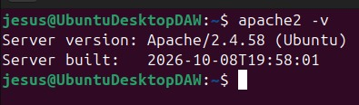

Primero ejecuté apache2 -v para ver qué versión tenía instalada. Me apareció Apache 2.4.58, así que no tuve que volver a instalarlo porque ya lo tenía de la práctica anterior.

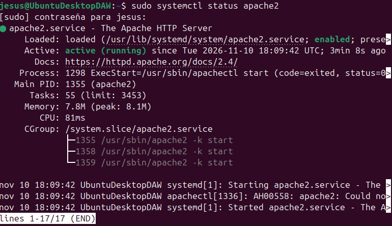

Después ejecuté sudo systemctl status apache2. Apareció active (running), así que pude comprobar que el servidor estaba encendido y funcionando.

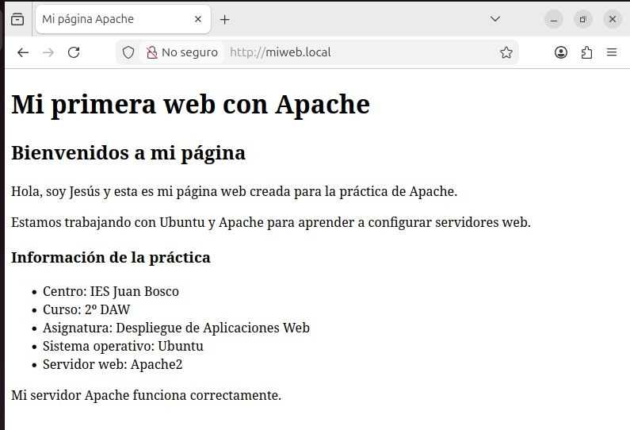

Abrí Firefox y entré en http://miweb.local. Se veía la página que había creado antes, así que comprobé que todo funcionaba con HTTP antes de cambiar a HTTPS.

### 2.2. Activación de ssl y headers

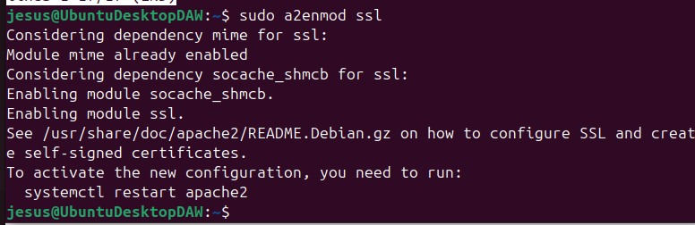

Ejecuté sudo a2enmod ssl para activar el módulo que necesita Apache para trabajar con HTTPS. La terminal indicó que se había habilitado.

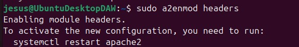

Después usé sudo a2enmod headers. Este módulo permite trabajar con cabeceras HTTP y también quedó habilitado correctamente.

Una vez activados los dos módulos, ejecuté sudo systemctl restart apache2 para aplicar los cambios.

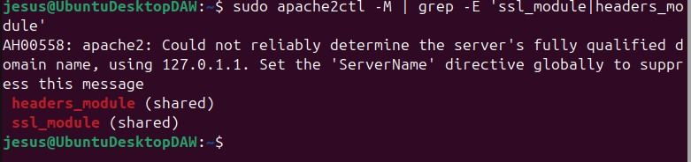

Con sudo apache2ctl -M | grep -E "ssl_module|headers_module" comprobé que aparecían ssl_module y headers_module. También salió el aviso AH00558 sobre el nombre global del servidor, pero no impidió seguir.

### 2.3. Creación del certificado SSL/TLS

Ejecuté openssl version para comprobar que tenía OpenSSL disponible. Apareció la versión 3.0.13, que es la herramienta que utilicé para crear el certificado.

Creé la carpeta /etc/apache2/ssl con sudo mkdir -p /etc/apache2/ssl. Aquí guardé los archivos que iba a utilizar Apache para HTTPS.

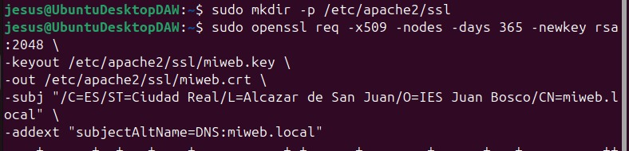

Utilicé openssl req para crear un certificado autofirmado válido durante 365 días para miweb.local. El comando generó el certificado miweb.crt y la clave privada miweb.key, e incluyó el nombre DNS miweb.local.

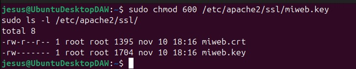

Con sudo chmod 600 /etc/apache2/ssl/miweb.key limité los permisos de la clave privada. Luego utilicé ls -l para comprobar que se habían creado tanto miweb.crt como miweb.key.

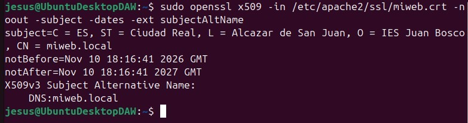

Con openssl x509 comprobé los datos del certificado. Aparecen miweb.local, las fechas de validez y DNS:miweb.local, así que tenía el nombre que necesitaba para mi página.

### 2.4. Configuración del VirtualHost HTTPS

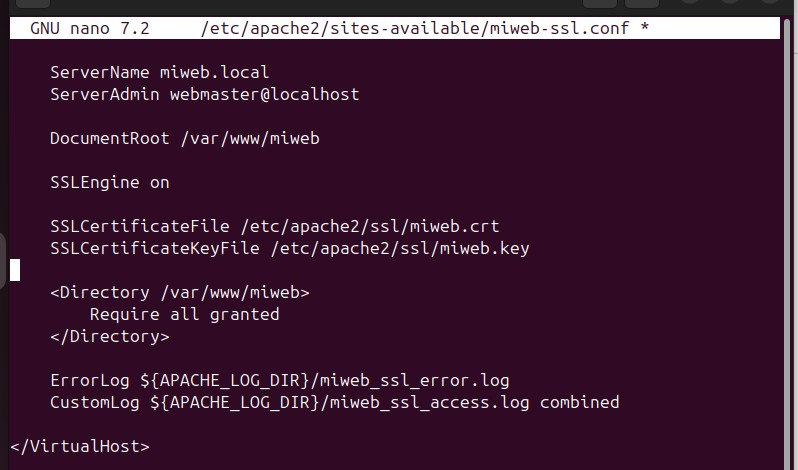

Creé el archivo miweb-ssl.conf para configurar el VirtualHost de HTTPS en el puerto 443. Dentro activé SSLEngine y añadí las rutas del certificado y de su clave privada, además de la carpeta donde está la web.

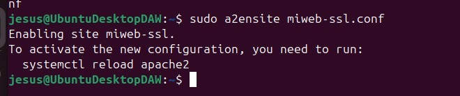

Después ejecuté sudo a2ensite miweb-ssl.conf para habilitar el nuevo sitio en Apache. La terminal confirmó que el sitio había quedado activado.

Ejecuté sudo systemctl restart apache2 para que el servidor cargara la nueva configuración HTTPS.

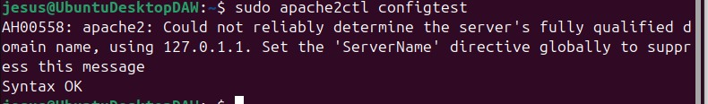

Con sudo apache2ctl configtest comprobé la configuración. Apareció Syntax OK, por lo que Apache no detectó errores de sintaxis. El aviso AH00558 volvió a salir, pero no bloqueó la práctica.

### 2.5. Pruebas de HTTPS

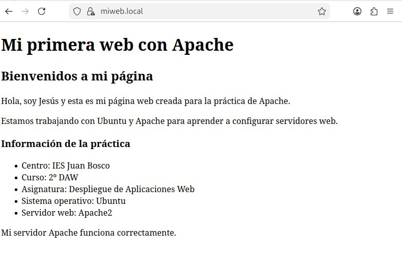

Abrí la misma página en Firefox utilizando HTTPS. Se veía el contenido de siempre, pero ahora la conexión usaba TLS. Como el certificado era autofirmado, el navegador no lo consideraba de confianza automáticamente.

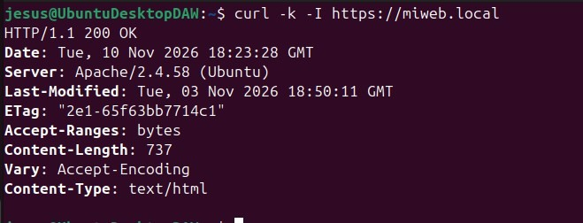

Ejecuté curl -k -I https://miweb.local y recibí HTTP/1.1 200 OK. Eso significa que Apache respondió bien por HTTPS. Usé -k solo porque el certificado es autofirmado y curl no puede verificar su confianza por defecto.

### 2.6. Redirección de HTTP a HTTPS

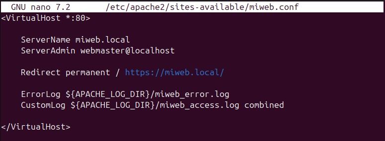

Después abrí miweb.conf y añadí Redirect permanent / https://miweb.local/. Así, cuando alguien entra por HTTP, Apache le indica que tiene que ir a la dirección HTTPS.

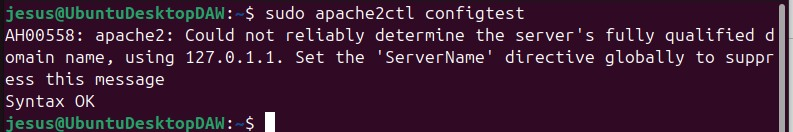

Ejecuté otra vez sudo apache2ctl configtest y apareció Syntax OK. De esta manera comprobé que no había errores de sintaxis después de modificar el VirtualHost HTTP.

Utilicé sudo systemctl reload apache2 para cargar la nueva configuración sin detener completamente el servicio.

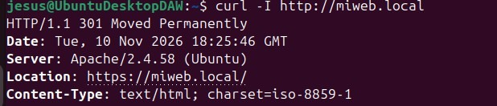

Por último ejecuté curl -I http://miweb.local. La respuesta fue HTTP/1.1 301 Moved Permanently y apareció Location: https://miweb.local/. Esto demuestra que la redirección HTTP a HTTPS funciona.

## 3. Resultados obtenidos

Al terminar la práctica conseguí que mi página miweb.local funcionara con HTTPS utilizando Apache en Ubuntu. También creé un certificado autofirmado, configuré el VirtualHost del puerto 443 y comprobé con curl que el servidor respondía con 200 OK.

Además, configuré la redirección desde HTTP hacia HTTPS. La respuesta 301 Moved Permanently confirmó que la redirección estaba funcionando. En las capturas se ve cómo fui haciendo cada paso y comprobando los resultados.

## 4. Problemas y dificultades

En esta práctica no tuve ningún fallo importante que me impidiera acabarla. Varias veces salió el aviso AH00558 porque Apache no tenía definido un ServerName global, pero como también aparecía Syntax OK pude continuar.

Otra cosa a tener en cuenta es que el navegador no confía automáticamente en el certificado, porque lo he creado yo mismo. Esto es normal en un certificado autofirmado: sirve para hacer las pruebas de cifrado, pero no es igual que tener uno firmado por una autoridad reconocida.

No he incluido una captura de la escucha del puerto 443 ni de los detalles del certificado en Firefox dentro de este archivo de imágenes. Por eso, las comprobaciones que documento son las que realmente aparecen: el sitio en el navegador, el certificado generado desde la terminal y las respuestas de curl.

## 5. Conclusión y valoración personal

Esta práctica me ha servido para entender mejor la diferencia entre HTTP y HTTPS. Antes ya tenía una página funcionando en Apache, pero ahora he aprendido a añadirle un certificado y a configurar las conexiones cifradas.

Lo que más interesante me ha parecido es que con unos cuantos comandos se puede crear el certificado y hacer que una página local funcione por HTTPS. También he aprendido para qué sirve la redirección, porque así los visitantes no se quedan usando HTTP.

En general, la práctica me ha salido bien. Algunos comandos eran nuevos para mí, pero al ir haciendo las comprobaciones paso a paso he podido ver para qué servía cada uno.

## 6. Bibliografía

Documentación de Apache HTTP Server: https://httpd.apache.org/docs/2.4/ssl/ssl_howto.html

Documentación de Ubuntu Server sobre Apache: https://ubuntu.com/server/docs

Documentación de OpenSSL: https://docs.openssl.org/
