# Nginx en Ubuntu

Autor: Jesús Andújar Fernández

## 1. Investigación

### 1.1. ¿Qué es Nginx?

Nginx es un programa que sirve para mostrar páginas web desde un servidor. Cuando escribimos una dirección en el navegador, el servidor recibe la petición y nos manda la página. También puede funcionar como proxy inverso, es decir, recibir las peticiones y pasárselas a otro servidor. Es gratuito y se utiliza bastante porque puede atender muchas conexiones sin gastar demasiados recursos.

### 1.2. Diferencias entre Apache y Nginx

Apache y Nginx sirven para mostrar páginas web, pero no funcionan exactamente igual. Apache suele trabajar con procesos o hilos, según su configuración, mientras que Nginx utiliza un sistema basado en eventos para atender muchas conexiones. En Apache configurábamos un VirtualHost y en Nginx utilizamos un bloque server, que viene a ser algo parecido.

Otra diferencia es que Apache puede utilizar archivos .htaccess para configurar ciertas cosas en carpetas concretas. Nginx no usa esos archivos y normalmente se configura desde sus propios ficheros. Los dos sirven perfectamente para montar una web sencilla como la que hemos hecho en clase.

### 1.3. Cómo se instala y se ejecuta en Ubuntu

En Ubuntu podemos instalar Nginx desde la terminal con sudo apt update y sudo apt install nginx -y. Después comprobamos que esté encendido con systemctl status nginx. Para crear nuestra página hacemos una carpeta con un index.html, configuramos un bloque server y comprobamos la configuración con sudo nginx -t. Si todo está bien, iniciamos o recargamos Nginx.

En mi caso he usado el puerto 8080 porque ya tenía Apache instalado y lo estaba utilizando en el puerto 80. De esta forma puedo tener los dos servidores en el mismo Ubuntu sin que intenten utilizar el mismo puerto.

## 2. Ejecución técnica

### 2.1. Preparar Ubuntu e instalar Nginx

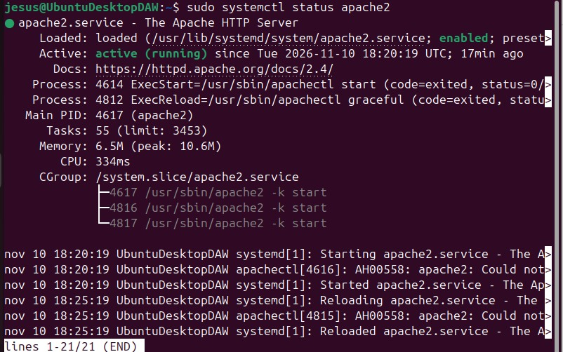

Antes de instalar nada comprobé que Apache seguía funcionando con sudo systemctl status apache2. En la captura aparece active (running), así que estaba encendido. Como Apache ya utilizaba el puerto 80, tenía que tenerlo en cuenta al instalar Nginx.

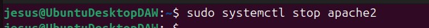

Utilicé sudo systemctl stop apache2 para detener Apache durante un momento. No lo desinstalé ni borré ninguna página; simplemente lo paré para evitar que chocara con Nginx durante la instalación.

Después ejecuté sudo systemctl is-active apache2. Me salió inactive, que significa que ya estaba detenido y podía seguir.

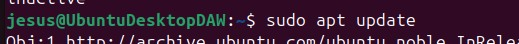

Ejecuté sudo apt update para actualizar la información de los programas disponibles en Ubuntu. Es un paso sencillo que conviene hacer antes de instalar un programa nuevo.

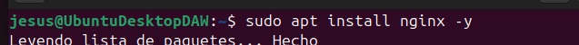

Luego escribí sudo apt install nginx -y. Con esto Ubuntu empezó a instalar Nginx. En la captura se ve el comando de instalación, aunque no está todo el resultado de la descarga.

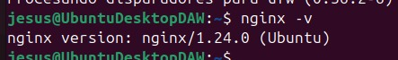

Para comprobar que Nginx estaba instalado utilicé nginx -v. Me apareció la versión nginx/1.24.0 (Ubuntu), así que ya estaba disponible en el equipo.

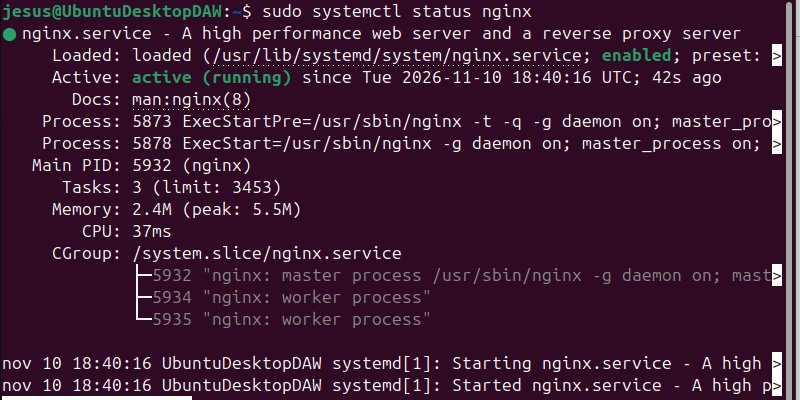

Después utilicé sudo systemctl status nginx. En la terminal salió active (running), que indica que Nginx se había iniciado correctamente.

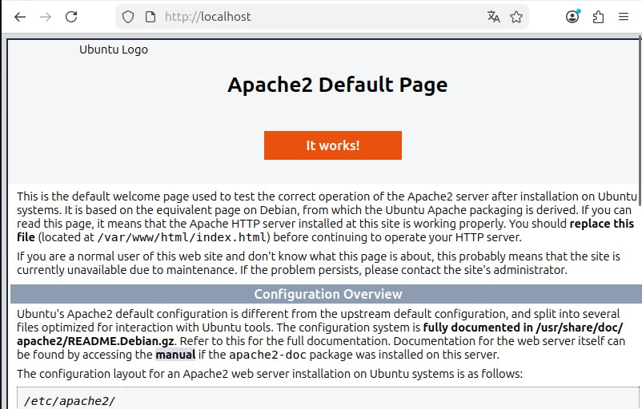

Abrí localhost en Firefox para comprobar qué aparecía. En esta captura se ve la página predeterminada de Apache, no la de Nginx. Por eso esta imagen, por sí sola, no demuestra que Nginx estuviera mostrando la página. Más adelante sí pude comprobar Nginx con mi dirección nginx.local:8080 y con curl.

### 2.2. Crear la página web personalizada

Creé la carpeta /var/www/nginxweb usando sudo mkdir -p /var/www/nginxweb. Ahí iba a guardar los archivos de mi página para no mezclarlos con los de Apache.

Con ls -l /var/www/ comprobé que se había creado nginxweb y que seguían existiendo las otras carpetas de la práctica anterior.

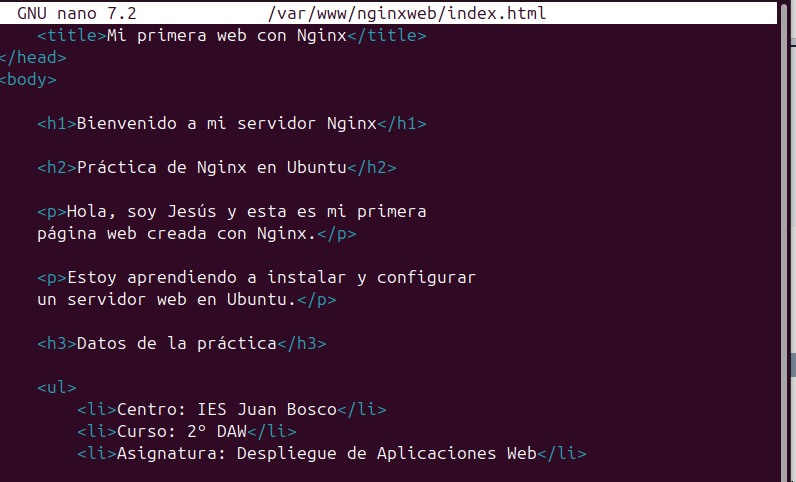

Abrí el archivo index.html con Nano y escribí una página básica con un título, algunos párrafos y los datos de la asignatura. No le puse estilos complicados porque aquí lo importante era que funcionara el servidor.

### 2.3. Configurar el bloque server de Nginx

Paré Nginx con sudo systemctl stop nginx para cambiar su configuración. Después lo volvería a iniciar con los nuevos ajustes.

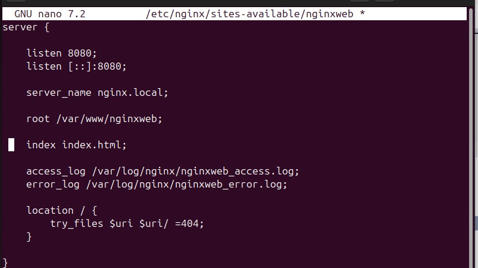

Creé el archivo /etc/nginx/sites-available/nginxweb. En él indiqué listen 8080, el nombre nginx.local y la carpeta /var/www/nginxweb. También añadí el archivo index.html, los registros y la regla try_files, que devuelve un error 404 si no encuentra lo que se pide.

Eliminé el enlace del sitio predeterminado con sudo rm -f /etc/nginx/sites-enabled/default. Esto evita que Nginx siga utilizando esa configuración en el puerto 80 y deja libre ese puerto para Apache.

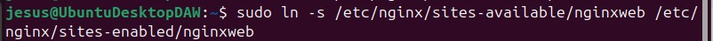

Creé un enlace desde sites-available a sites-enabled para activar el archivo nginxweb. Así Nginx ya podía utilizar la configuración de nuestra página.

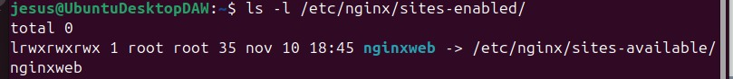

Con ls -l /etc/nginx/sites-enabled/ comprobé que aparecía el enlace nginxweb. Esto me permitió verificar que el archivo estaba habilitado.

### 2.4. Validar y aplicar los cambios

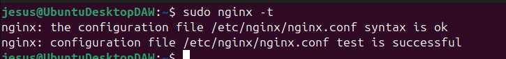

Ejecuté sudo nginx -t antes de iniciar el servicio. Aparecieron los mensajes syntax is ok y test is successful, así que Nginx no encontró errores de sintaxis en la configuración.

Utilicé sudo systemctl start apache2 para recuperar el servidor que habíamos detenido al principio. La idea era seguir teniendo disponible la web de Apache.

Después ejecuté sudo systemctl start nginx. Como Nginx estaba configurado en el puerto 8080, podía estar encendido a la vez que Apache.

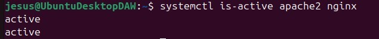

Con systemctl is-active apache2 nginx aparecieron dos líneas con active. Eso significa que tanto Apache como Nginx estaban iniciados.

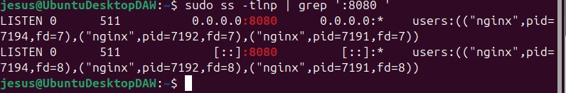

Ejecuté sudo ss -tlnp | grep ":8080 " y aparecieron líneas LISTEN relacionadas con nginx. Esto confirma que estaba escuchando en el puerto 8080, tanto en IPv4 como en IPv6.

### 2.5. Comprobar que la web funciona

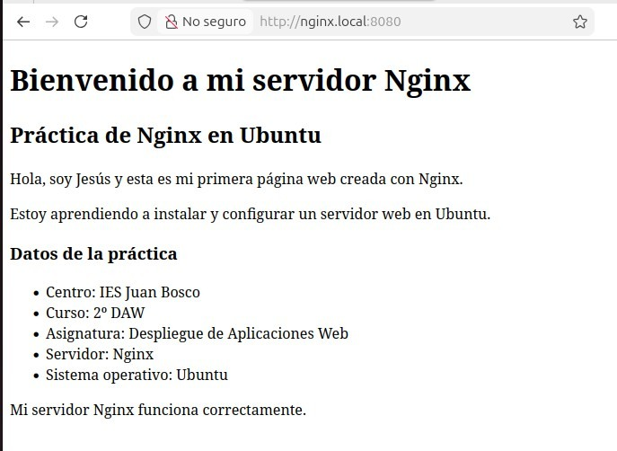

Entré en http://nginx.local:8080 desde Firefox. Esta vez sí apareció mi página con el título «Bienvenido a mi servidor Nginx», los párrafos y los datos de clase. Aquí ya pude comprobar que el sitio estaba funcionando como quería.

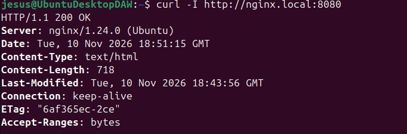

Por último utilicé curl -I http://nginx.local:8080. La respuesta fue HTTP/1.1 200 OK y Server: nginx/1.24.0 (Ubuntu). Esto demuestra que Nginx respondió correctamente a la petición.

## 3. Resultados obtenidos

Al terminar he conseguido instalar Nginx en Ubuntu y crear una página web que se abre desde nginx.local:8080. También he comprobado que Nginx está activo, que escucha en el puerto 8080 y que curl devuelve 200 OK. Además, Apache seguía funcionando al mismo tiempo, ya que cada servidor utilizaba un puerto distinto.

La prueba que mejor demuestra que todo funciona es la de Firefox con mi página personalizada, porque se ve el resultado final de una manera muy clara.

## 4. Problemas y dificultades

La principal cosa que había que tener en cuenta era que ya tenía Apache instalado y utilizando el puerto 80. Para no tener problemas, primero lo detuve, instalé Nginx y después configuré Nginx en el puerto 8080. Así pude volver a encender los dos.

Otra cosa curiosa fue que, al entrar en localhost durante las primeras comprobaciones, apareció la página de Apache. Esa captura no sirve para demostrar que Nginx funcionaba. Para comprobarlo bien utilicé después nginx.local:8080 y el comando curl, donde sí apareció el nombre de Nginx.

En las capturas no se ve ningún error importante de configuración: la comprobación con nginx -t terminó correctamente.

## 5. Conclusión

Esta práctica me ha servido para aprender a instalar otro servidor web diferente a Apache. Al principio parecía que iba a ser casi lo mismo, pero la configuración cambia un poco. Lo que más me ha servido ha sido entender el bloque server y cómo elegir una carpeta y un puerto para mostrar una página.

También he aprendido que puedo tener Apache y Nginx en el mismo ordenador si los configuro para que no utilicen el mismo puerto. Al final conseguí abrir la página y comprobarlo desde la terminal, así que la práctica quedó funcionando.

## 6. Bibliografía

Documentación de Ubuntu: https://ubuntu.com/server/docs/how-to/web-services/install-nginx/

Configuración de Nginx en Ubuntu: https://ubuntu.com/server/docs/how-to/web-services/configure-nginx/

Guía oficial de Nginx: https://nginx.org/en/docs/beginners_guide.html
